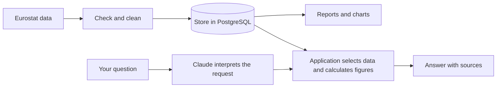

# Eurostat Economic Data & AI Questions

[](https://github.com/hassanzafarr/eurostat-etl-airflow/actions/workflows/ci.yml)

**Explore European GDP and employment data, then ask questions about it in plain English.**

This project collects official statistics from Eurostat, checks them, and keeps them in a database. You can compare countries, explore changes over time, and use Claude to help explain the results with figures and source links.

Built by Hassan Zafar using Python, Apache Airflow, PostgreSQL, Docker, and Claude Haiku.

## What can you do with it?

- **Ask a question:** “How did Germany's GDP change between 2015 and 2025?”
- **Compare countries:** “Compare Germany and France employment rates in the latest available year.”
- **View a report:** open charts and an optional AI summary of the stored data.
- **Keep data updated:** run the collection yourself or let Airflow check for updates each day while the services are running.

The saved data covers **2015–2025** for Germany, France, Italy, Spain, the Netherlands, Poland, and the EU aggregate. Later runs may add years or update earlier figures.

## See an example


For the Germany GDP question above, the verified snapshot shows an increase from **€3,094.19 billion** in 2015 to **€4,529.71 billion** in 2025: a **46.39% nominal increase**. These figures use current prices, so they include price changes.

The application retrieves the data and calculates the numbers. Claude interprets your question and helps write the explanation. Answers include the supporting observations and Eurostat sources.

You can browse the [sample AI report](docs/AI_REPORT_SAMPLE.md), [charts and analysis](docs/ANALYSIS.md), and [downloaded data](docs/data) without running the project.

## Try it locally

You need Docker running with Linux containers and Docker Compose. On Windows, use Docker Desktop with WSL2. Allow at least 4 GB of memory for the demo.

### 1. Set up

From the project folder, copy the example settings:

```powershell
# Windows PowerShell
Copy-Item .env.example .env
```

```bash
# macOS / Linux
cp .env.example .env
```

To ask questions or get AI commentary, add your Anthropic API key to `ANTHROPIC_API_KEY` in `.env`. Requests use your Anthropic account and may incur charges. Keep this file private. Data collection and charts work without a key.

Start the services:

```bash
docker compose up --build -d
```

The first startup takes a few minutes. If needed, use `docker compose ps` to check that PostgreSQL, the scheduler, and the webserver are healthy.

### 2. Collect the data

1. Open [Airflow at localhost:8080](http://localhost:8080).
2. Log in with **airflow / airflow**, unless you changed the settings.
3. Find **eurostat_economic_indicators** and turn on its toggle.
4. Click its **▶ button** on the right and trigger a run.
5. Wait for all five tasks to turn green.

Airflow can then check for updates daily at **06:00 UTC** while the services are running. The measurements themselves are annual.

### 3. Ask your question

1. Open the [Ask Eurostat form](http://localhost:8080/dags/ask_eurostat/trigger). You can also click the **▶ button** beside **ask_eurostat** on the DAGs page.
2. Type a prompt in **Your question**, such as “How did Germany's GDP change between 2015 and 2025?”
3. Click **Trigger** and wait for the run to finish.
4. In the run's grid, click its small green square beside **answer_question**, then select **Logs**.
5. Search the logs for **ASK EUROSTAT ANSWER** to read the response.

Each run answers one question. The latest answer is also saved to `artifacts/questions/latest.md` in your project folder. See the [question guide](docs/ASK_EUROSTAT.md) for more prompts and supported questions.

### 4. Open the report

After the data run, open `artifacts/insights/latest.html` in your browser for GDP and employment charts, supporting data, and AI commentary when available. Without a key, the report still includes data and charts and clearly labels the missing AI commentary.

## How it works



Airflow coordinates collection and reporting. Python checks the data before saving it, and PostgreSQL updates existing records when Eurostat revises a figure. Claude works within supported questions about the stored data.

## What has been checked?

The [recorded GitHub Actions run](https://github.com/hassanzafarr/eurostat-etl-airflow/actions/runs/41718240379) passed **121 tests**, including data validation, database updates, workflow checks, and AI response checks. Collection, reporting, and a real question were also verified locally. See the [verification record](docs/VERIFICATION.md) for evidence and limits.

This is a local portfolio project. Questions cover stored GDP and employment comparisons and trends; forecasts and explanations of economic causes are outside its scope. Employment rates cover ages 15–64, both sexes. The EU aggregate includes the selected countries, so it should not be added to their totals.

## Explore further

| If you want to… | Read |
|---|---|
| Try more questions | [Question guide](docs/ASK_EUROSTAT.md) |
| Set up Claude reports | [AI setup and behavior](docs/AI_INTEGRATION.md) |
| Understand the figures | [Data dictionary](docs/DATA_DICTIONARY.md) and [analysis](docs/ANALYSIS.md) |
| Inspect the code or run tests | [Developer guide](docs/DEVELOPMENT.md) |
| Understand technical tradeoffs | [Design decisions](docs/DESIGN.md) |
| Stop services or troubleshoot | [Operations guide](docs/OPERATIONS.md) |
| Present the project | [Demo walkthrough](docs/DEMO.md) |

## Sources and license

Data comes from Eurostat's [GDP](https://ec.europa.eu/eurostat/databrowser/view/nama_10_gdp/default/table?lang=en) and [employment](https://ec.europa.eu/eurostat/databrowser/view/lfsi_emp_a/default/table?lang=en) datasets. See [Eurostat's reuse notice](https://ec.europa.eu/eurostat/help/copyright-notice) for data terms.

Project code is licensed under [MIT](LICENSE).
