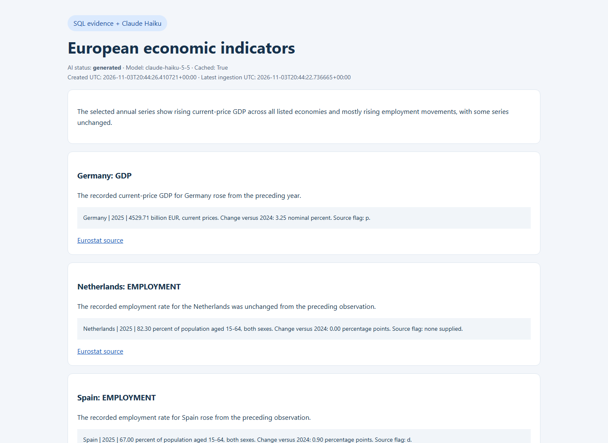

# Captured Claude Haiku report

This is a real report generated with `claude-haiku-5-5` from the verified PostgreSQL observations. Figures and chart data are calculated by SQL. The subsequent Airflow run reused cached commentary without another API request. This captured example is dated; it is not a live dashboard.

# Eurostat economic report

AI status: generated
Model: claude-haiku-5-5
Cached commentary: True
Report created (UTC): 2026-11-03T20:44:26.410721+00:00

The selected annual series show rising current-price GDP across all listed economies and mostly rising employment movements, with some series unchanged.

## Evidence-linked findings

- The recorded current-price GDP for Germany rose from the preceding year.
  Germany | 2025 | 4529.71 billion EUR, current prices. Change versus 2024: 3.25 nominal percent. Source flag: p.
  Source: https://ec.europa.eu/eurostat/databrowser/view/nama_10_gdp/default/table?lang=en
- The recorded employment rate for the Netherlands was unchanged from the preceding observation.
  Netherlands | 2025 | 82.30 percent of population aged 15-64, both sexes. Change versus 2024: 0.00 percentage points. Source flag: none supplied.
  Source: https://ec.europa.eu/eurostat/databrowser/view/lfsi_emp_a/default/table?lang=en
- The recorded employment rate for Spain rose from the preceding observation.
  Spain | 2025 | 67.00 percent of population aged 15-64, both sexes. Change versus 2024: 0.90 percentage points. Source flag: d.
  Source: https://ec.europa.eu/eurostat/databrowser/view/lfsi_emp_a/default/table?lang=en
- Current-price GDP for the EU aggregate rose from the preceding year.
  EU aggregate | 2025 | 18884.57 billion EUR, current prices. Change versus 2024: 4.16 nominal percent. Source flag: none supplied.
  Source: https://ec.europa.eu/eurostat/databrowser/view/nama_10_gdp/default/table?lang=en
- The recorded employment rate for Poland rose from the preceding observation.
  Poland | 2025 | 72.80 percent of population aged 15-64, both sexes. Change versus 2024: 0.30 percentage points. Source flag: none supplied.
  Source: https://ec.europa.eu/eurostat/databrowser/view/lfsi_emp_a/default/table?lang=en

## Verified latest observations

- Germany | 2025 | 4529.71 billion EUR, current prices. Change versus 2024: 3.25 nominal percent. Source flag: p. Source: https://ec.europa.eu/eurostat/databrowser/view/nama_10_gdp/default/table?lang=en
- Spain | 2025 | 1690.01 billion EUR, current prices. Change versus 2024: 5.72 nominal percent. Source flag: p. Source: https://ec.europa.eu/eurostat/databrowser/view/nama_10_gdp/default/table?lang=en
- EU aggregate | 2025 | 18884.57 billion EUR, current prices. Change versus 2024: 4.16 nominal percent. Source flag: none supplied. Source: https://ec.europa.eu/eurostat/databrowser/view/nama_10_gdp/default/table?lang=en
- France | 2025 | 2991.06 billion EUR, current prices. Change versus 2024: 1.90 nominal percent. Source flag: p. Source: https://ec.europa.eu/eurostat/databrowser/view/nama_10_gdp/default/table?lang=en
- Italy | 2025 | 2265.00 billion EUR, current prices. Change versus 2024: 2.46 nominal percent. Source flag: none supplied. Source: https://ec.europa.eu/eurostat/databrowser/view/nama_10_gdp/default/table?lang=en
- Netherlands | 2025 | 1170.58 billion EUR, current prices. Change versus 2024: 4.96 nominal percent. Source flag: none supplied. Source: https://ec.europa.eu/eurostat/databrowser/view/nama_10_gdp/default/table?lang=en
- Poland | 2025 | 923.51 billion EUR, current prices. Change versus 2024: 8.36 nominal percent. Source flag: none supplied. Source: https://ec.europa.eu/eurostat/databrowser/view/nama_10_gdp/default/table?lang=en
- Germany | 2025 | 77.20 percent of population aged 15-64, both sexes. Change versus 2024: 0.00 percentage points. Source flag: none supplied. Source: https://ec.europa.eu/eurostat/databrowser/view/lfsi_emp_a/default/table?lang=en
- Spain | 2025 | 67.00 percent of population aged 15-64, both sexes. Change versus 2024: 0.90 percentage points. Source flag: d. Source: https://ec.europa.eu/eurostat/databrowser/view/lfsi_emp_a/default/table?lang=en
- EU aggregate | 2025 | 71.00 percent of population aged 15-64, both sexes. Change versus 2024: 0.30 percentage points. Source flag: none supplied. Source: https://ec.europa.eu/eurostat/databrowser/view/lfsi_emp_a/default/table?lang=en
- France | 2025 | 69.30 percent of population aged 15-64, both sexes. Change versus 2024: 0.50 percentage points. Source flag: d. Source: https://ec.europa.eu/eurostat/databrowser/view/lfsi_emp_a/default/table?lang=en
- Italy | 2025 | 62.50 percent of population aged 15-64, both sexes. Change versus 2024: 0.30 percentage points. Source flag: none supplied. Source: https://ec.europa.eu/eurostat/databrowser/view/lfsi_emp_a/default/table?lang=en
- Netherlands | 2025 | 82.30 percent of population aged 15-64, both sexes. Change versus 2024: 0.00 percentage points. Source flag: none supplied. Source: https://ec.europa.eu/eurostat/databrowser/view/lfsi_emp_a/default/table?lang=en
- Poland | 2025 | 72.80 percent of population aged 15-64, both sexes. Change versus 2024: 0.30 percentage points. Source flag: none supplied. Source: https://ec.europa.eu/eurostat/databrowser/view/lfsi_emp_a/default/table?lang=en

## Interpretation limits

- GDP uses current prices. Its change is nominal, not inflation-adjusted growth.
- Employment covers ages 15-64, both sexes. Rate differences are percentage points.
- Annual observations are checked for updates daily; these are not daily measurements.
- The EU aggregate overlaps the selected countries and must not be added to their totals.
- Source flags can mark provisional values, estimates or breaks in series. Check source metadata before drawing conclusions.
- Numerical evidence and trend labels are validated. Qualitative AI wording still requires human review; this report establishes no causes or forecasts.
