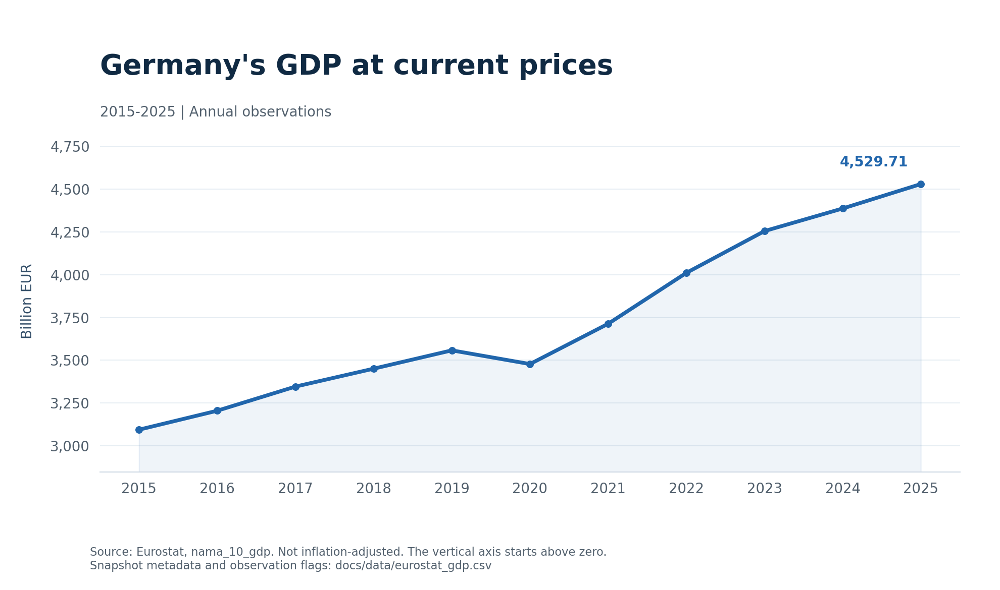
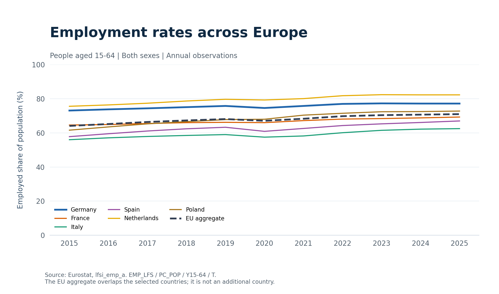

# Analysis of the verified snapshot

Source: European Commission, Eurostat. Export timestamp: 2026-11-03T19:59:50.232826+00:00.

## Germany GDP

Germany GDP at current prices increased from 3,094.19 billion EUR in 2015 to 4,529.71 billion EUR in 2025, a nominal change of 46.39%. This comparison includes price changes and must not be interpreted as inflation-adjusted growth.

## Employment in 2025

Rates describe employed people aged 15-64 as a percentage of the population in that group, both sexes combined.

| Geography | Employment rate | Source flag |
|---|---:|---|
| NL | 82.3% | - |
| DE | 77.2% | - |
| PL | 72.8% | - |
| EU27_2020 | 71.0% | - |
| FR | 69.3% | d |
| ES | 67.0% | d |
| IT | 62.5% | - |

The EU aggregate overlaps the individual countries and is not another country. These comparisons describe the selected indicators only; they do not establish causes of differences. Source flags are retained in CSV files for interpretation against Eurostat metadata.

## Reproduce

Run sql/analysis.sql against the eurostat database, export a new snapshot with scripts/export_data.py, and render it with scripts/plot_analysis.py. SQL annual changes require consecutive calendar years. Missing years are not interpolated.
