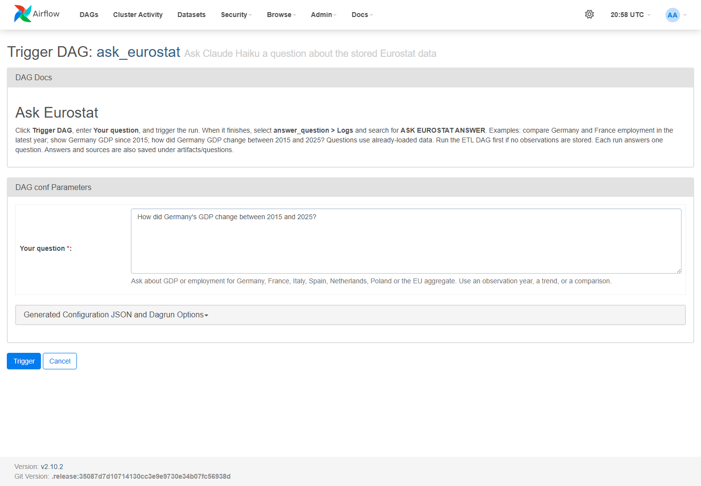
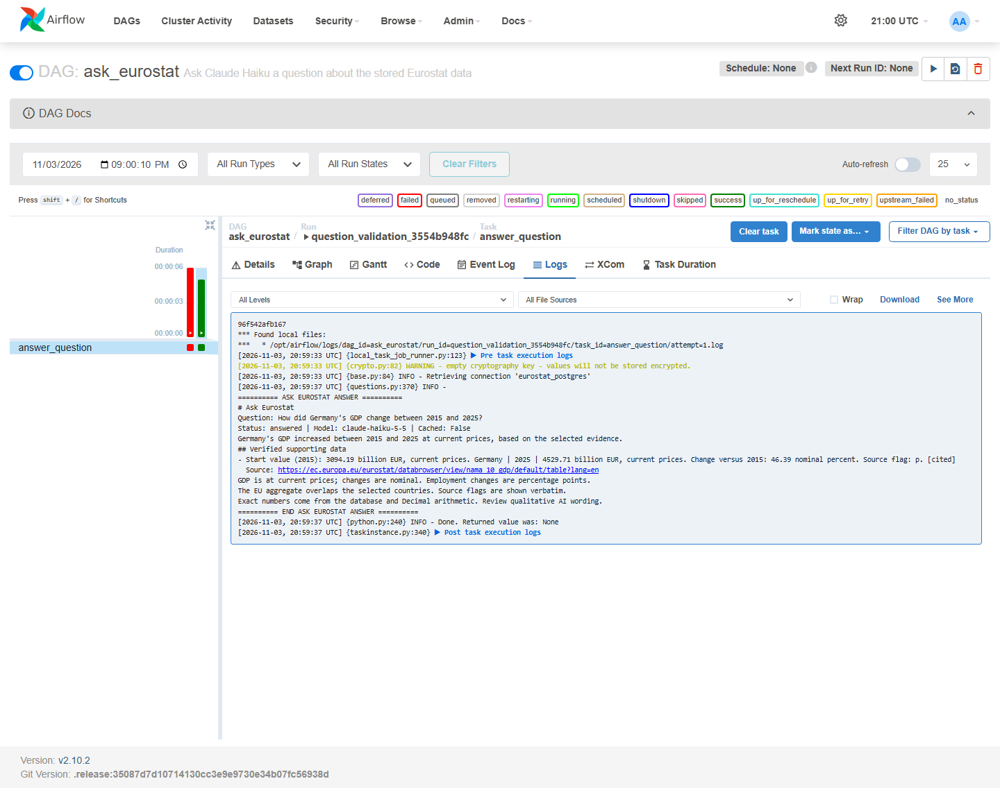

# Ask Claude from Airflow

Open [the Ask Eurostat form](http://localhost:8080/dags/ask_eurostat/trigger), or find **ask_eurostat** on the Airflow DAGs page and click its play/trigger button.

1. Enter your question in **Your question**.
2. Click **Trigger**.
3. Select the new run and click **answer_question > Logs**.
4. Search for **ASK EUROSTAT ANSWER** to see the answer, verified numbers, and sources.

## Example questions

- Compare Germany and France employment rates in the latest available year.
- Show Germany's GDP trend from 2015 to 2025.
- How did Germany's GDP change between 2015 and 2025?
- How many percentage points did Germany's employment rate change between 2015 and 2025?
- Compare GDP for Germany, France, and Italy in 2024.

The snapshot currently covers 2015-2025. Available geographies are Germany, France, Italy, Spain, Netherlands, Poland, and the EU aggregate. Supported indicators are GDP at current prices and employment rates for ages 15-64, both sexes. Requested years must exist in the stored data. Missing observations and endpoints are not invented or interpolated.

## Verified live example

Question: **How did Germany's GDP change between 2015 and 2025?**

Claude described the increase, while application-calculated supporting data showed:

| Observation | Verified value |
|---|---:|
| GDP in 2015 | 3,094.19 billion EUR |
| GDP in 2025 | 4,529.71 billion EUR |
| Nominal change over the period | 46.39% |

This is current-price change, not inflation-adjusted growth. Source: Eurostat nama_10_gdp. The ending observation's source flag is shown in the answer.

## Behavior and limits

`ask_eurostat` is a separate, manually triggered DAG with no schedule. It reads the existing database and does not rerun ingestion. Each run answers one question; it is not a continuous chat session. The configured local Anthropic key and Haiku model are reused. Run the main ETL DAG first if the database has no data.

Claude first returns a constrained plan selecting a trend, comparison, or endpoint-change operation. Country and indicator names are allowlisted. The application applies that selection to a consistent snapshot read through fixed read-only SQL. Endpoint arithmetic uses Decimal values, including percentage-point differences for employment. No model-generated SQL or database write operation is accepted.

Supported questions use at most two bounded Claude requests: planning and evidence-linked answering. There are no automatic retries. Unsupported questions and unavailable selections stop after planning and explain the limitation. Identical questions reuse a local cache when source evidence, model and prompts match; cache hits make no request. Broad selections are limited to eighty observations and should be narrowed if necessary.

Answer prose may repeat verified calendar years; exact measurement figures and sources are appended by the application. Citations must refer to known selected observations. Common causal, forecasting and source-flag claims are rejected. Qualitative wording still requires human review.

Questions, answers, and sources are saved under **artifacts/questions**, including `latest.md` and `latest.json`. That folder is ignored by Git. Questions also appear in Airflow's run configuration and logs. Only the example question shown here is included in public documentation; runtime question history and credentials are not published.
